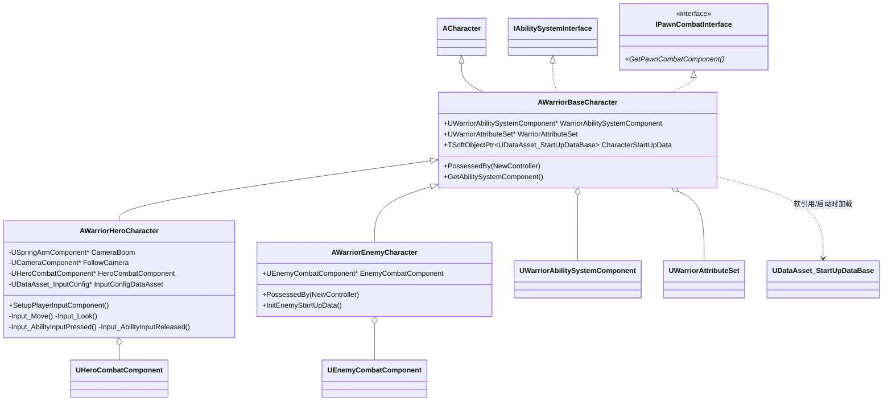
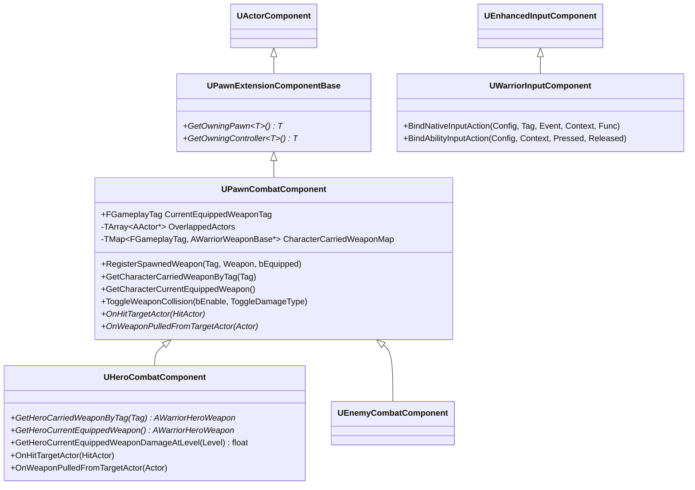
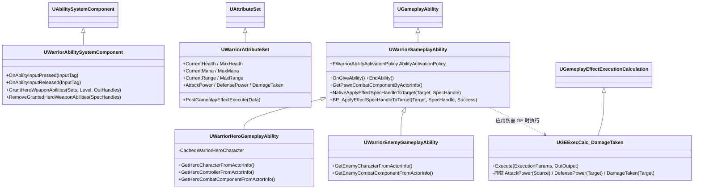
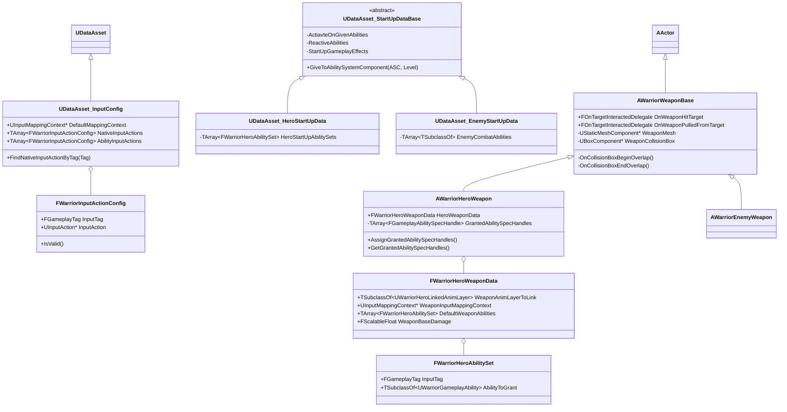
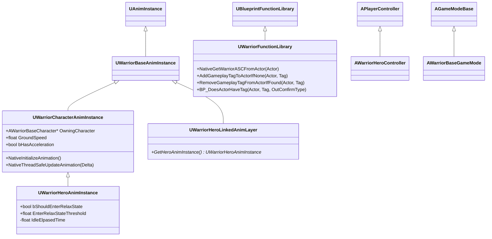

# 03 - 类图说明

> 返回索引：[项目说明.md](./项目说明.md)
> 类清单与职责见 [02-模块归纳.md](./02-模块归纳.md)
> 以下均为 Mermaid 语法，Typora / VS Code / Obsidian / GitHub 可直接渲染。
> 最近更新：2026-11-16（Day5 攻击→伤害→扣血→死亡链路）

## 4.1 角色与组件继承体系

## 4.2 组件体系

## 4.3 技能系统（GAS）体系

## 4.4 数据资产与武器体系

## 4.5 动画与辅助类体系

